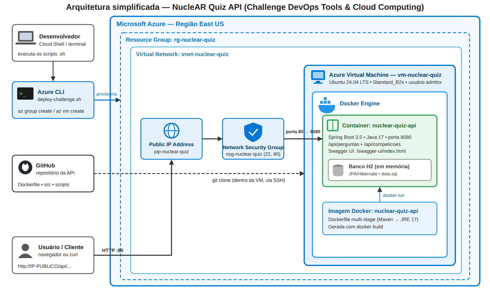

# NucleAR Quiz — API | Challenge FIAP 2026 (CTMSP / Amazul)
## DevOps Tools & Cloud Computing — 1º Sprint

## 👥 Integrantes

| Nome | RM | Turma |
|------|----|-------|
| Felipe Cuesta Puerta de Oliveira | 567703 | 2TDSPR |
| Vitor Costa de Godoi | 568448 | 2TDSPR |
| Vitor Santos Domingues | 568375 | 2TDSPR |
| João Victor De Souza Braz | 566862 | 2TDSPR |
| Lucas Pompeu | 567010 | 2TDSPR |

**Vídeo de demonstração (YouTube, não listado):** `<<LINK DO VÍDEO>>`

---

## 📌 Sobre a prova de conceito

O **NucleAR Quiz** é uma plataforma de quizzes com competições temáticas que mostra o lado pacífico e útil da tecnologia nuclear (medicina, agricultura, indústria e geração de energia). A API REST (Java 17 + Spring Boot 3.5) gerencia **perguntas** educativas e **competições**.

Esta prova de conceito demonstra a API **containerizada com Docker** e **executando em uma VM Linux no Microsoft Azure**, provisionada 100% via **Azure CLI** (Infraestrutura como Código). A documentação completa dos endpoints da API está em [`docs/API.md`](docs/API.md).

## 🏗️ Arquitetura



| Componente | Função |
|---|---|
| **Azure CLI** (`deploy-challenge.sh`) | Provisiona a infraestrutura por código |
| **Resource Group** `rg-nuclear-quiz` | Agrupa os recursos e permite apagar tudo de uma vez |
| **VNet / Public IP / NSG** | Rede, IP público e firewall (portas 22 e 80) |
| **Azure Virtual Machine** (Ubuntu 24.04, Standard_B2s) | Hospeda o Docker |
| **Docker Engine** | Gera a imagem pelo Dockerfile e executa o container |
| **Container `nuclear-quiz-api`** | API Spring Boot (porta 8080), publicada na porta 80 da VM |
| **Banco H2 (em memória)** | Embutido na API; é populado no início pelo `data.sql` |
| **GitHub** | Armazena o código; dentro da VM (via SSH) fazemos `git clone` do repositório |

**Fluxo:** Usuário → `HTTP :80` → IP Público → NSG (libera 80) → VM → mapeamento `80:8080` → container `nuclear-quiz-api` → H2.

> O H2 é em memória: os dados reiniciam a cada execução do container (adequado para a PoC). Em produção, o banco seria um serviço gerenciado (ex.: Azure Database for PostgreSQL/MySQL).

## 📁 Estrutura do repositório

```
.
├── Dockerfile                      # Multi-stage: build Maven + JRE 17 enxuto, usuário não-root
├── .dockerignore
├── pom.xml
├── src/                            # Código da API (Spring Boot)
├── scripts/
│   ├── deploy-challenge.sh         # Azure CLI: cria RG + VM + porta 80 e mostra o IP
│   ├── setup-vm.sh                 # Dentro da VM (SSH): instala Docker, build e run (atalho)
│   ├── testar-api.sh               # Testa a API pelo IP público
│   └── cleanup-challenge.sh        # Apaga o Resource Group e comprova a exclusão
└── docs/
    ├── arquitetura.svg | .png      # Diagrama
    ├── API.md                      # Documentação e exemplos de payload da API
    └── ROTEIRO_VIDEO.md            # Roteiro do vídeo
```

## 🐳 Executando com Docker (teste local, opcional)

```bash
docker build -t nuclear-quiz-api .
docker run -d --name nuclear-quiz-api -p 8080:8080 nuclear-quiz-api
curl http://localhost:8080/api/perguntas
# Swagger: http://localhost:8080/swagger-ui/index.html
docker rm -f nuclear-quiz-api
```

## ☁️ Executando no Azure

### Parte 1 — Criar a VM com Azure CLI (Cloud Shell ou terminal com `az`)

```bash
git clone https://github.com/PompeuDev/nuclear-quiz-devops.git
cd nuclear-quiz-devops
chmod +x scripts/*.sh

az login        # no Cloud Shell ja vem autenticado
./scripts/deploy-challenge.sh | tee deploy-challenge.log   # pede a senha da VM
```

O script cria o Resource Group, a VM Ubuntu 24.04, abre a porta 80 e mostra o **IP público**.

### Parte 2 — Configurar o Docker dentro da VM (via SSH)

```bash
ssh admlnx@<IP_PUBLICO>          # digite "yes" e a senha definida no deploy

# Dentro da VM:
sudo apt-get update && sudo apt-get install -y docker.io
sudo systemctl enable --now docker
docker --version

git clone https://github.com/PompeuDev/nuclear-quiz-devops.git
cd nuclear-quiz-devops

sudo docker build -t nuclear-quiz-api .                                   # gera a imagem (alguns minutos)
sudo docker run -d --name nuclear-quiz-api -p 80:8080 nuclear-quiz-api    # executa o container
sudo docker ps
sudo docker logs nuclear-quiz-api
curl http://localhost/api/perguntas
exit
```

> Atalho: em vez dos comandos acima, dentro da VM e na pasta do repositório, rode `chmod +x scripts/*.sh && sudo ./scripts/setup-vm.sh`.

### Parte 3 — Testar pelo IP público e apagar os recursos

```bash
./scripts/testar-api.sh <IP_PUBLICO>        # ou abra http://<IP_PUBLICO>/swagger-ui/index.html
./scripts/cleanup-challenge.sh              # apaga o Resource Group e comprova a exclusao
```

### Comandos Azure CLI utilizados

| Etapa | Comando |
|---|---|
| Versão / assinatura | `az --version` · `az account show` |
| Grupo de recursos | `az group create --name rg-nuclear-quiz --location eastus` |
| VM | `az vm create --resource-group rg-nuclear-quiz --name vm-nuclear-quiz --image Ubuntu2404 --size Standard_B2s --authentication-type password --admin-username admlnx --admin-password '<senha>' --vnet-name vnet-nuclear-quiz --nsg nsg-nuclear-quiz --public-ip-address pip-nuclear-quiz` |
| Abrir porta HTTP | `az vm open-port --resource-group rg-nuclear-quiz --name vm-nuclear-quiz --port 80 --priority 1001` |
| IP público | `az vm show -d -g rg-nuclear-quiz -n vm-nuclear-quiz --query publicIps -o tsv` |
| Validar recursos | `az resource list -g rg-nuclear-quiz -o table` |
| **Excluir recursos** | `az group delete --name rg-nuclear-quiz --yes` |
| Comprovar exclusão | `az group exists --name rg-nuclear-quiz` (retorna `false`) |

> ⚠️ A senha da VM **não** é gravada no repositório: ela é digitada na execução (ou passada via variável `ADMIN_PASSWORD`).

## 💬 Como Docker e Cloud Computing podem ser utilizados na solução proposta pelo grupo?

Na solução **NucleAR Quiz**, o **Docker** empacota a API (Java 17 + Spring Boot) com todas as suas dependências em uma única imagem. O `Dockerfile` usa *multi-stage build*: um estágio compila o projeto com Maven e o estágio final carrega apenas o JRE e o `.jar`, gerando uma imagem menor e mais segura (usuário não-root). Assim, a API roda de forma idêntica no notebook de cada integrante, na VM de testes e em produção, acabando com o “na minha máquina funciona” e facilitando o versionamento e o deploy.

A **Cloud Computing (Microsoft Azure)** fornece a infraestrutura sob demanda para disponibilizar a plataforma na internet: o público do quiz e as competições precisam de uma API acessível a qualquer momento e que suporte picos de acesso, como no encerramento de uma competição. Com o **Azure CLI** criamos VM, rede, IP público e regras de firewall em minutos, pagamos apenas enquanto usamos e removemos tudo apagando o grupo de recursos. Como todo o provisionamento está em scripts (IaC), o ambiente é reproduzível e auditável, e pode evoluir para múltiplas instâncias, banco de dados gerenciado (em vez do H2 em memória) e serviços como Azure Container Apps. Juntos, Docker e Azure entregam portabilidade, escalabilidade, automação e redução de custos para o projeto.
